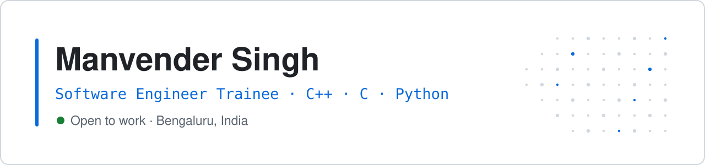

<!--
  Profile README for github.com/nickittime.
  Goes in a PUBLIC repo named exactly "nickittime" (not yet created), with the two
  banner SVGs in an "assets" folder next to it.
-->

<picture>
  <source media="(prefers-color-scheme: dark)" srcset="./assets/banner-dark.svg">
  <source media="(prefers-color-scheme: light)" srcset="./assets/banner-light.svg">
  
</picture>

# Manvender Singh

**Software Engineer (2027 Grad) · C++ · Python · Backend & Applied AI**

Final-year B.E. Information Science student in Bengaluru.  
I build backend, storage, and AI systems in C++ and Python—and verify them against invariants, crash states, and deterministic guardrails.

**Open to work:** Entry-Level Software Engineer (SDE-1), Backend, Systems & Applied AI roles · **Available full-time starting Jan 2027** (Bengaluru / Open to relocate)

[Email](mailto:work.singhmanvender16@gmail.com) · [LinkedIn](https://www.linkedin.com/in/manvender-singh-90a53a300) · [Portfolio](https://nickittime.github.io) · [Resume](https://nickittime.github.io)

---

## About

- **Education:** B.E. in Information Science Engineering, Sir M. Visvesvaraya Institute of Technology, Bengaluru (2023 – 2027)
- **Patent:** Co-inventor on a published Indian patent — *Context-Aware Device Usage Identification Using Sensor Transformation and Lightweight Knowledge Distillation* (Pub. No. `IN202641130247 A1` / App. No. `202641130247 A`)
- **Research:** Conference paper on longitudinal smartphone behavioral forecasting, accepted at **DSISys 2026**
- **Problem Solving:** 200+ data structures and algorithms problems solved in C++ and Python

---

## Tech Stack

| Area | Technologies |
| :--- | :--- |
| **Languages** | C++ (C++17), C, Python, SQL, TypeScript |
| **Backend & Data** | FastAPI, Node.js, PostgreSQL, ClickHouse, Redis, pandas, NumPy, ChromaDB |
| **Testing & DevOps** | GoogleTest, pytest, CMake, Git, GitHub Actions, Docker, Linux |
| **Core CS** | Data Structures & Algorithms, OOP, Operating Systems, DBMS, Computer Networks |

---

## Featured Projects

### kvlite — Key-Value Store in C++17
`C++17` `CMake` `GoogleTest` `GitHub Actions`
- In-memory key-value store supporting O(1) LRU eviction (hash map + doubly linked list), expiring keys, and an append-only log replayed on restart.
- Detects and truncates incomplete trailing log records from simulated crashes to maintain recovery integrity.
- Verified with **34 GoogleTest tests**, including **20,000 random operations** checked against a reference model, with CI running on GCC, Clang, MSVC, and AddressSanitizer.

### Freight Cost Watcher — Anomaly Detection with a Guardrailed LLM
`Python` `pandas` `ChromaDB` `Groq LLM API` `pytest` `Docker`
- Detects sudden spikes and slow cost creep across **7 Indian road corridors (728 route-weeks)** using own-route and peer-route baselines with a hysteresis rule.
- Pairs LLM root-cause proposals across 22 candidates with **5 deterministic guardrails** that decide whether to accept each explanation.
- Validated with **39 offline tests**: caught **9/9 planted events**, produced identical output across **3 cold runs**, and runs deterministically without an API key.

### Aegis Risk Engine — Risk-Management API for a Lender
`Python` `FastAPI` `PostgreSQL` `ClickHouse` `Redis` `Docker`
- Implements credit, market, and operational risk engines alongside RBI provisioning and regulatory-return generation.
- Enforces JWT login, MFA for elevated roles, and four-eyes approval for credit overrides, with SFTP batch ingestion into ClickHouse.
- Backed by **11 unit tests** and a GitHub Actions CI pipeline running **Ruff**, **Bandit**, and **pytest**.

---

## Contact

- **Email:** [work.singhmanvender16@gmail.com](mailto:work.singhmanvender16@gmail.com) *(fastest way to reach me)*
- **LinkedIn:** [linkedin.com/in/manvender-singh-90a53a300](https://www.linkedin.com/in/manvender-singh-90a53a300)
- **Portfolio:** [nickittime.github.io](https://nickittime.github.io)
- 
